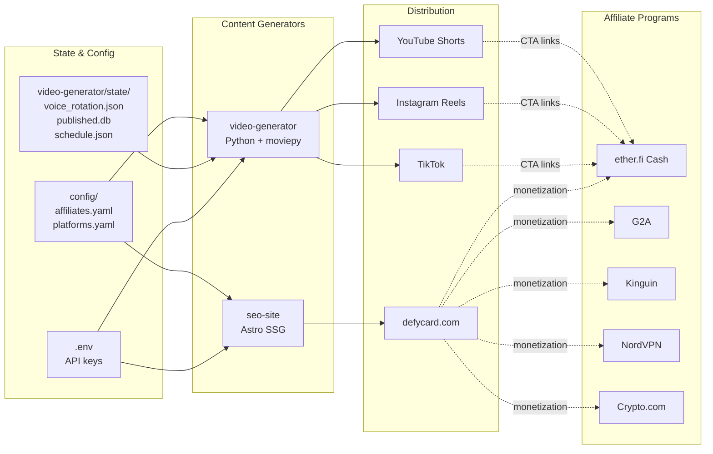
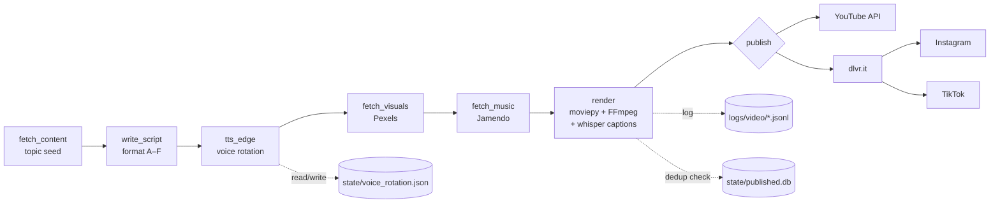
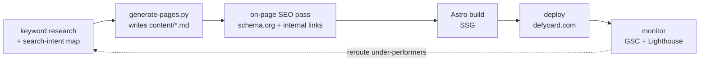
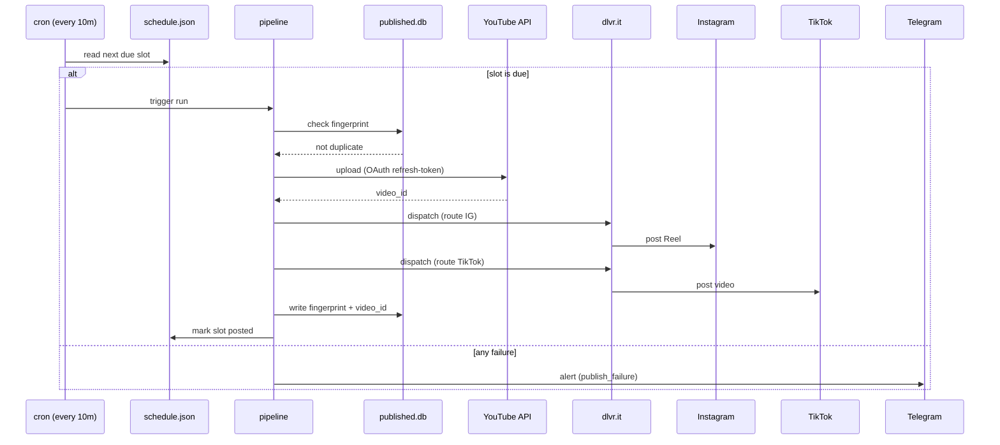

# DefyCard — Architecture

Four diagrams. Render with any Mermaid-capable viewer (GitHub, VS Code, Obsidian).

---

## 1. Project ecosystem

---

## 2. Video pipeline

---

## 3. SEO pipeline

---

## 4. Publishing flow

---

## File responsibilities

| Path | Owner | Purpose |
|---|---|---|
| `CLAUDE.md` | Workspace | Operating contract for Claude |
| `.claude/CLAUDE.md` | Workspace | Project-specific conventions |
| `.claude/commands/*.md` | Workspace | Slash-command prompt templates |
| `.claude/hooks/secret-scan.sh` | Workspace | PreToolUse secret scan |
| `.claude/settings.json` | Workspace | Claude Code config + hook registration |
| `video-generator/config.yaml` | Pipeline | Output specs, schedule policy |
| `video-generator/templates/scenarios.md` | Pipeline | Script formats A–F |
| `video-generator/templates/hooks.md` | Pipeline | Opening-line pool |
| `video-generator/state/voice_rotation.json` | Pipeline | Round-robin TTS state |
| `config/affiliates.yaml` | Both | Centralized referral URLs |
| `config/platforms.yaml` | Both | Distribution + SEO targets |
| `docs/architecture.md` | Workspace | This file |
| `.claude/skills/design-system/SKILL.md` | Workspace | Canonical UI tokens (Catppuccin Latte/Mocha) — single source of truth for `seo-site/` colours, components, accessibility |

---

## Out of scope (deferred)

- Pipeline Python source (`video-generator/pipeline/*.py`)
- Astro app (`seo-site/src/`, `astro.config.mjs`)
- Helper scripts (`scripts/backup.sh`, `scripts/generate-pages.py`)
- Cron entrypoint (`video-generator/cron/run.sh`)
- Remote Git origin
