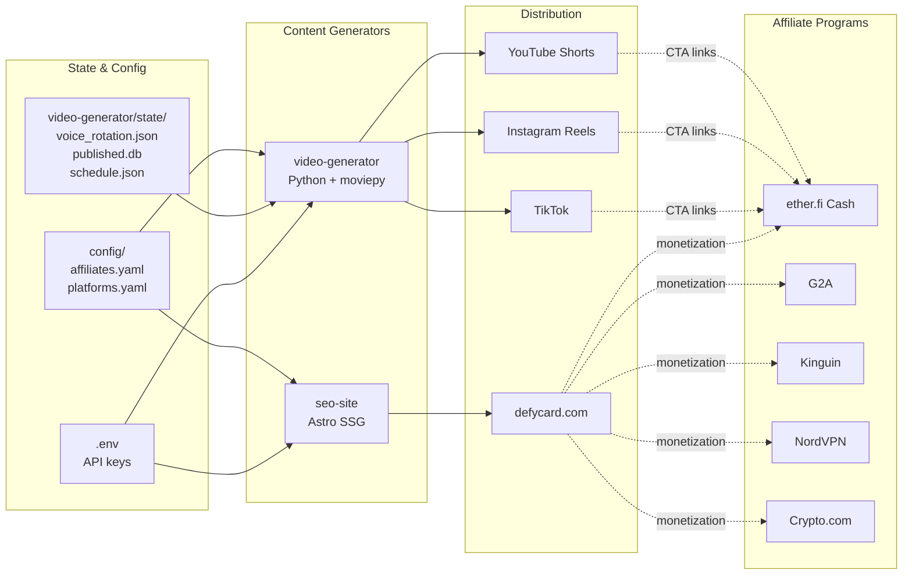
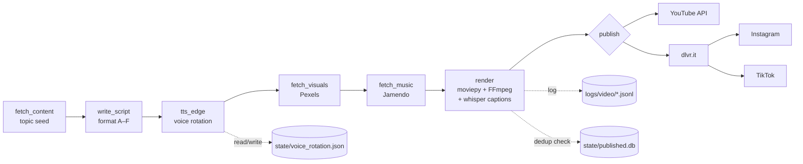
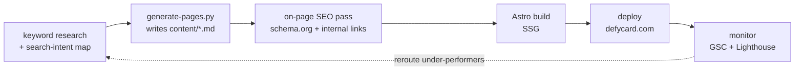
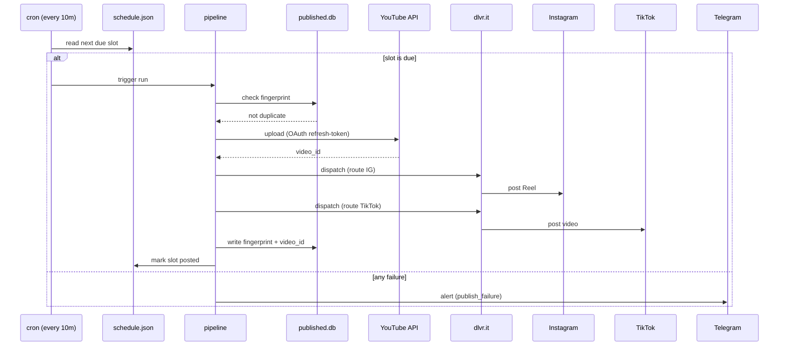

# DefyCard — Architecture

Four diagrams. Render with any Mermaid-capable viewer (GitHub, VS Code, Obsidian).

---

## 1. Project ecosystem

---

## 2. Video pipeline

---

## 3. SEO pipeline

### Pages feed and Medium eligibility

`seo-site/scripts/build-markdown.js` (deploy step 1c) writes `dist/feed/pages.json`: a JSON array, newest `date_published` first, at most 200 entries, each `{url, title, type, date_published, date_modified, words, medium_eligible}`. `words` counts the whole markdown body (not style-lint's prose count). Metadata only: no body text, no affiliate URLs. nginx serves it as `application/json` to any UA with `Cache-Control: public, max-age=600`. The article body for each URL is the existing `Accept: text/markdown` copy (title as `# `, body only; no related-links block). Mirrors on Medium (canonical = the defycard.com page) come from the profile https://medium.com/@defycard, listed in the Organization JSON-LD `sameAs` (`seo-site/src/data/entity.json`) and in one `llms.txt` line; no footer link.

`medium_eligible` is the G37b verdict stored in each page's frontmatter: `scripts/style-lint.py` (a verbatim copy of the sales file, never edited here) run by `humanize_gate.humanize(..., g37b=True)` after the G37 score. A RED lint adds its reasons to the one existing copy-edit call; both lints re-run on the result; still RED keeps the original text, publishes as today and sets `medium_eligible: false`. G37b never blocks a page. Existing pages were set once by `scripts/medium-eligible-backfill.py`. An absent field means false.

---

## 4. Publishing flow

---

## File responsibilities

| Path | Owner | Purpose |
|---|---|---|
| `CLAUDE.md` | Workspace | Operating contract for Claude |
| `.claude/CLAUDE.md` | Workspace | Project-specific conventions |
| `.claude/commands/*.md` | Workspace | Slash-command prompt templates |
| `.claude/hooks/secret-scan.sh` | Workspace | PreToolUse secret scan |
| `.claude/settings.json` | Workspace | Claude Code config + hook registration |
| `video-generator/config.yaml` | Pipeline | Output specs, schedule policy |
| `video-generator/templates/scenarios.md` | Pipeline | Script formats A–F |
| `video-generator/templates/hooks.md` | Pipeline | Opening-line pool |
| `video-generator/state/voice_rotation.json` | Pipeline | Round-robin TTS state |
| `config/affiliates.yaml` | Both | Centralized referral URLs |
| `config/platforms.yaml` | Both | Distribution + SEO targets |
| `docs/architecture.md` | Workspace | This file |
| `.claude/skills/design-system/SKILL.md` | Workspace | Canonical UI tokens (Catppuccin Latte/Mocha) — single source of truth for `seo-site/` colours, components, accessibility |

---

## Out of scope (deferred)

- Pipeline Python source (`video-generator/pipeline/*.py`)
- Astro app (`seo-site/src/`, `astro.config.mjs`)
- Helper scripts (`scripts/backup.sh`, `scripts/generate-pages.py`)
- Cron entrypoint (`video-generator/cron/run.sh`)
- Remote Git origin
